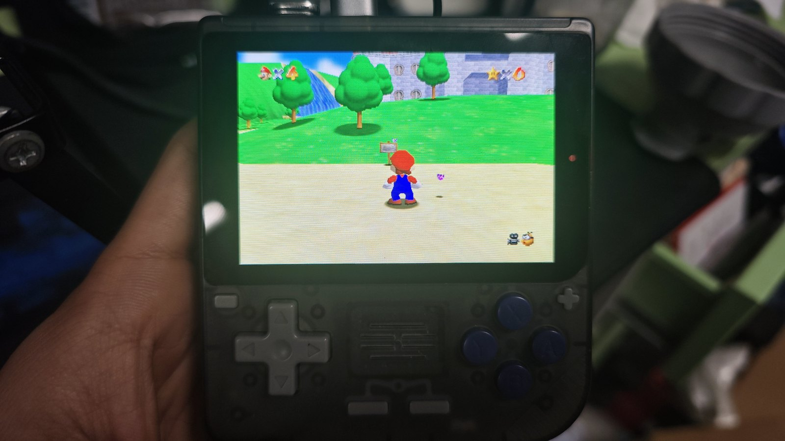
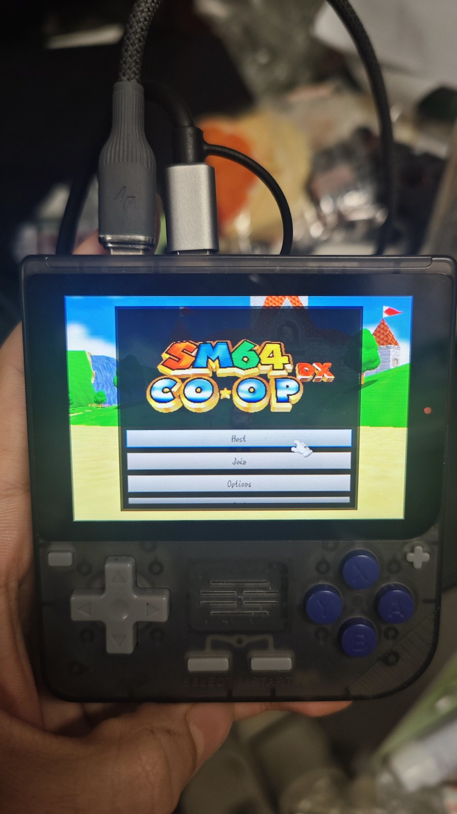
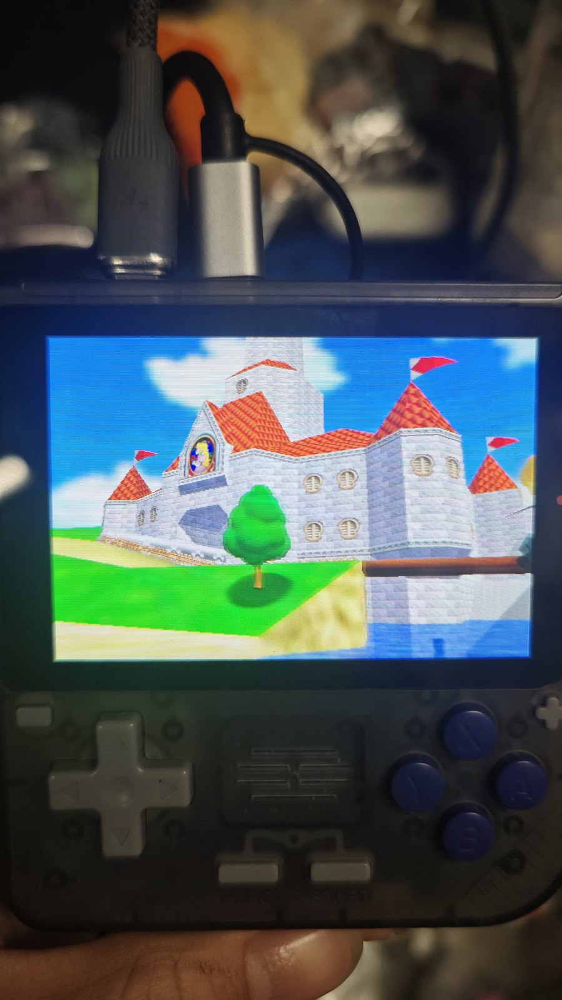

<div align="center">

# SM64coopdx for Powkiddy RGB10

**把 Super Mario 64 联机版（sm64coopdx v1.5.1）塞进百元级开源掌机 —— RK3326 + Mali-G31 + ArkOS 的 aarch64 / OpenGL ES 2.0 移植**

[]()
[]()
[]()
[]()
[](https://github.com/coop-deluxe/sm64coopdx)
[](https://github.com/TC635807/sm64coopdx-rgb10/releases)

**开箱即用的 Ports 包 · 3 个可复现补丁 · 单摇杆手柄的 C 摇杆映射 · 52 FPS @ 480×320**



<sub>Powkiddy RGB10 实机：Bob-omb Battlefield。方向键移动，按住 L1 + ABXY 转视角（手机翻拍，屏幕实际 480×320）</sub>

</div>

---

> 上游项目：[coop-deluxe/sm64coopdx](https://github.com/coop-deluxe/sm64coopdx)（v1.5.1）。
> 本仓只包含让它在 RGB10 上跑起来所需的东西：3 个源码补丁、交叉构建脚本、ArkOS Ports 启动器、默认手柄配置、移植踩坑记录，以及可直接安装的 Release 包。
> 不包含上游源码与 ROM —— 构建时自备 `baserom.us.z64`。

<a id="toc"></a>

## 📋 目录

- [亮点](#highlights) · [运行环境](#env)
- [实机演示](#demo) · [控制方案](#controls)
- [快速开始](#quickstart) · [仓库结构](#layout)
- [从源码构建](#build) · [移植踩坑](#pitfalls)
- [已知限制](#limits) · [文档](#docs) · [许可与致谢](#license)

<a id="highlights"></a>

## ✨ 亮点

- **开箱即用**：Release 里是一个 ArkOS Ports 目录结构，解压到 `/roms/ports` 就能在 EmulationStation 看到 `sm64coopdx`，自带二进制、dynos、11 种语言、mods、配色表。
- **真正的交叉编译产物**：aarch64 ELF，最高 GLIBC 2.29 / GLIBCXX 3.4.26，只依赖 RGB10 自带的 libMali（GLES2）与 SDL2 2.30；设备端零编译。
- **单摇杆手柄也能转视角**：RGB10 只有一组 ABXY + 一个摇杆，通过 25 行 SDL 层补丁实现「方向键=移动、按住 L1 + ABXY=C 摇杆」，且按住 L1 时 ABXY 原动作被正确屏蔽。
- **补丁化、可复现**：上游 v1.5.1 + 3 个 patch，`scripts/apply-patches.sh` 一键应用，构建命令见 [从源码构建](#build)。
- **踩坑有据可查**：交叉产物启动即 SIGSEGV（glibc crt1 导致 C++ 静态构造不执行）、Mali 对 GLSL ES 1.00 的严格类型检查……根因与验证过程都在 [移植踩坑](#pitfalls) 和 [`docs/PORTING-FIXES.md`](docs/PORTING-FIXES.md)。
- **60 FPS 上限**：`vsync true` + `frame_limit 60`，主菜单实测 ~52 FPS；MSAA 关闭、贴图过滤 1 档，优先保帧率。

<a id="env"></a>

## 🧩 运行环境

| 项目 | 值 |
|---|---|
| 设备 | Powkiddy RGB10（RK3326） |
| CPU | 4 × Cortex-A35 @ 1.3 GHz |
| GPU | Mali-G31 MP2（硬件支持 GLES 3.2，本移植走 GLES 2.0 路径 → libMali） |
| 内存 | 893 MB 可用，**无 swap** |
| 屏幕 | 3.5 英寸 480×320（4:3），KMSDRM 直出 |
| 系统 | ArkOS 2.0（12242024 版），Ubuntu 19.10 aarch64，glibc 2.30，kernel 4.4.189 |
| 显示服务 | 无 X11 / Wayland；SDL2 2.30 KMSDRM + 面板旋转补丁 |
| 上游 | sm64coopdx v1.5.1，`TARGET_RPI=1 machine=aarch64` |

<a id="demo"></a>

## 🎬 实机演示

<p align="center">
  
  &nbsp;&nbsp;&nbsp;
  
</p>

<p align="center">
  <sub>左：主菜单（Host / Join / Options）· 右：城堡外景。顶部为 USB-C 供电 + Type-C 以太网适配器（SSH 部署用）</sub>
</p>

游戏内画面见页首大图。菜单与关卡均为 480×320 原生分辨率，非整数缩放。

<a id="controls"></a>

## 🎮 控制方案

RGB10 只有一组 ABXY、一个左摇杆、D-pad、L1/L2/R1/R2 —— 没有 C 摇杆。默认配置把相机交给「L1 + ABXY」：

| 输入 | 作用 |
|---|---|
| **D-pad** | 移动角色（映射为左摇杆 ±127，同时从按键位里剔除，不会转相机） |
| 左摇杆 | 移动角色（与 D-pad 等价） |
| A / B | 跳跃 / 原 B 动作 |
| X / Y | 原 X / Y 动作 |
| **按住 L1 + X / Y / A / B** | C 摇杆：**上 / 左 / 右 / 下**（相机视角） |
| 按住 L1 时 | A/B/X/Y 的原动作被屏蔽，只输出 C 摇杆，不会误跳 / 误踢 |
| Z | 默认绑 R2 轴（`0x101b`），同时保留了 X 键绑定（见 [已知限制](#limits)） |
| Start / Select | 暂停菜单 / 玩家列表 |

> 为什么必须打补丁：sm64coopdx 的按键绑定每个动作只有 **3 个并列槽位**（键盘 / 手柄按钮 / 轴），没有「修饰键 + 组合键」概念，所以 L1 组合键在纯配置下无解。需要在 `controller_sdl_read()` 末尾做一次按键合成 —— 见 [`patches/0003-rgb10-controller-mapping.patch`](patches/0003-rgb10-controller-mapping.patch)。

默认配置随包提供：`config/sm64config.txt`（安装后位于 `~/.local/share/sm64coopdx/sm64config.txt`，改乱可用同目录的 `sm64config.txt.default` 恢复）。

<a id="quickstart"></a>

## 🚀 快速开始

### 1. 下载 Release

从 [Releases](https://github.com/TC635807/sm64coopdx-rgb10/releases) 下载 `sm64coopdx-rgb10-v1.0.0.tar.gz`（约 35 MB），解压得到：

```text
sm64coopdx-rgb10-v1.0.0/
├── sm64coopdx.sh          # ArkOS Ports 启动器
└── sm64coopdx/            # 游戏本体 + dynos / lang / mods / palettes
```

### 2. 放进 Ports 目录

任选其一：

**A. 读卡器 / 文件管理器**（最省事）：把 `sm64coopdx.sh` 放到 `/roms/ports/`，把 `sm64coopdx/` 整个目录放到 `/roms/ports/sm64coopdx/`。

**B. SSH**（设备已联网）：

```bash
scp sm64coopdx.sh ark@<设备IP>:/roms/ports/
scp -r sm64coopdx ark@<设备IP>:/roms/ports/
```

### 3. 放入 ROM（必须，自备正版卡带 dump）

游戏从用户数据目录读取 US 版 ROM：

```text
~/.local/share/sm64coopdx/baserom.us.z64
```

US 版校验：`md5 20b854b239203baf6c961b850a4a51a2`（`sha1 9bef1128717f958171a4afac3ed78ee2bb4e86ce`）。也可以先放在 `/roms/ports/sm64coopdx/`，首次启动时游戏会自行复制。

### 4. 启动

EmulationStation → **Ports** → **sm64coopdx**。

- 单人：主菜单 `Host` → 直接开始
- 联机：`Host` 建房 / `Join` 加入（需要真实互联网，见 [已知限制](#limits)）
- 退出：游戏内 `Start` → 退出 / Stop Hosting → 主菜单 `Quit`

> ⚠️ 一定要以 `ark` 用户启动（ES 的 Ports 机制本来就是这样）。以 `root` 启动会把用户目录当成 `/root`，游戏会找不到 ROM。

### 开发者：SSH 一键部署

```bash
# PC 侧
scp sm64coopdx-rgb10-v1.0.0.tar.gz ark@<设备IP>:/tmp/
scp -r scripts config ark@<设备IP>:/tmp/port/
ssh ark@<设备IP> 'bash /tmp/port/scripts/deploy.sh --tarball /tmp/sm64coopdx-rgb10-v1.0.0.tar.gz --rom /path/to/your.z64'
```

`deploy.sh` 会解包、归位、修权限、归一化 mtime、装启动器、写默认配置、装 ROM，最后自检。

<a id="layout"></a>

## 🗂 仓库结构

```text
sm64coopdx-rgb10/
├── README.md
├── CHANGELOG.md
├── NOTICE.md                     # 版权 / ROM / 免责声明
├── patches/                      # 打在 upstream v1.5.1 上的 3 个补丁
│   ├── 0001-gles2-glsl-es-100-strictness.patch
│   ├── 0002-coopnet-stdcxx-compat.patch
│   └── 0003-rgb10-controller-mapping.patch
├── scripts/
│   ├── apply-patches.sh          # 拉 upstream v1.5.1 后一键打补丁
│   ├── build-cross.sh            # aarch64 交叉构建（需 sysroot，见 docs/CROSS-BUILD.md）
│   ├── package-release.sh        # 生成 Release 用的 Ports 目录包
│   ├── deploy.sh                 # 在设备上安装 / 部署
│   └── sm64coopdx.sh             # ArkOS Ports 启动器
├── config/
│   ├── sm64config.txt            # 默认配置（含最终控制方案）
│   └── gamecontrollerdb.txt      # 手柄映射数据库（247 条）
├── docs/
│   ├── PORTING-FIXES.md          # 4 个移植问题的根因与修复
│   ├── CROSS-BUILD.md            # 交叉工具链、5 个兼容问题、校验方法
│   └── img/                      # 实机照片
├── toolchain/
│   ├── eoan-arm64-dev.list       # Ubuntu 19.10 (eoan) arm64 开发包下载地址
│   └── debs.sha256               # 包校验
└── .gitignore
```

> `src/`、`toolchain/debs/`、`artifacts/`、`dist/` 都是本地构建用的，不入库（见 `.gitignore`）。

<a id="build"></a>

## 🛠 从源码构建

### 0. 前提

- Linux x86-64 PC（本项目在 WSL2 Ubuntu 上完成），`git`、`make`、`patch`
- **自备 US 版 ROM**（放到源码根目录并命名为 `baserom.us.z64`）
- 交叉工具链与 sysroot：见 [`docs/CROSS-BUILD.md`](docs/CROSS-BUILD.md)（gcc-12-aarch64、eoan arm64 头文件、SDL2 2.30 头、从设备同步的运行库）

### 1. 取源码 + 打补丁

```bash
git clone https://github.com/coop-deluxe/sm64coopdx.git
cd sm64coopdx
git checkout v1.5.1
bash /path/to/sm64coopdx-rgb10/scripts/apply-patches.sh .
cp /path/to/your.z64 baserom.us.z64
```

### 2. 交叉构建

```bash
export PATH="$HOME/rgb10-cross/bin:$PATH"     # 交叉 gcc / g++ / cpp / sdl2-config wrapper
bash /path/to/sm64coopdx-rgb10/scripts/build-cross.sh .
# 产物：build/us_pc/sm64coopdx.arm（TARGET_RPI=1 的上游命名）
```

等价手写命令：

```bash
make TARGET_RPI=1 machine=aarch64 CROSS=aarch64-linux-gnu- -j$(nproc)
```

### 3. 打包成 Ports 目录

```bash
bash scripts/package-release.sh build/us_pc/sm64coopdx.arm --version v1.0.0
# 输出 dist/sm64coopdx-rgb10-v1.0.0.tar.gz
```

<a id="pitfalls"></a>

## 🩺 移植踩坑（4 个真问题）

| # | 现象 | 根因 | 修复 |
|---|---|---|---|
| 1 | 设备原生编译必然 `virtual memory exhausted` | 生成的 `custom_textures.c` / 字体 `.inc.c` 单文件 10–40 MB，cc1 需要 1.5–2 GB；设备 893 MB 无 swap | 放弃设备编译，改 PC 交叉编译 |
| 2 | 交叉产物启动即 SIGSEGV，崩在 `dynos_smlua_clear_gfx_command_cache()` | 交叉工具链自带的 `crt1.o`（glibc 2.34+）不再向 `__libc_start_main` 传 init 指针，设备 glibc 2.30 不执行 `.init_array` → **所有 C++ 全局构造被跳过** | wrapper 加 `-B<sysroot>/usr/lib/aarch64-linux-gnu/`，强制用设备 crt |
| 3 | `Fragment shader compilation failed: 0:94: Type mismatch ... float and int` | Mali 对 GLSL ES 1.00 严格，桌面 GL 放行的 int/float 隐式转换在这里直接报错 | `gfx_opengl.c` 两处：`- 2` → `- 2.0`，`int levels = int(...)` → `float levels = ...` |
| 4 | D-pad 不识别 / 没有 C 摇杆 | 绑定系统无组合键；D-pad 默认被当成相机方向键 | SDL 层补丁：D-pad → 左摇杆，L1+ABXY → C 按钮（`0003`） |

另有 5 个兼容点在 [`docs/CROSS-BUILD.md`](docs/CROSS-BUILD.md)：eoan SDL2 2.0.10 头缺 `preciseX/preciseY`、`gcc -E` 不认 `.mk` 导致 `level_headers.h` 为空、g++12 头文件与 glibc 2.30 混用、预编译 `libcoopnet-arm64.a` 引用 GCC11 新符号（`0002` 补丁）、glibc 2.30 的 `shm_open` 在 librt。

<a id="limits"></a>

## ⚠️ 已知限制

- **联机需要真实互联网**：验证时设备是「PC ↔ Type-C 网卡」链路本地直连（169.254.x.x），没有公网出口，所以只验证了单机。想联机请给 RGB10 配 WiFi dongle / USB 网卡，并保证能访问 `net.coop64.us:34197`（CoopNet）。
- **菜单没有中文**：上游 `lang/` 只有 11 种语言，当前为 English。
- **内存紧张**：893 MB 可用、无 swap。加载大型 mod / 高模 dynos 包可能变慢或失败。
- **只验证了 US 版 ROM**（`baserom.us.z64`）；JP / SH / EU 版未测。
- **Z 键重复绑定**：默认 `key_z` 同时绑了 X 键（`0x1002`）与 R2 轴（`0x101b`），按住 L1+X 转视角时可能同时触发 Z。介意的话把 `config/sm64config.txt` 里 `key_z 0025 1002 101b` 的 `1002` 改回 `ffff`。
- **主菜单 ~52 FPS**（`frame_limit 60` + vsync）；具体关卡帧率未逐关测量。
- **无震动**：RGB10 没有马达，`rumble_strength` 保留默认但不生效。

<a id="docs"></a>

## 📚 文档

| 文档 | 内容 |
|---|---|
| [`docs/PORTING-FIXES.md`](docs/PORTING-FIXES.md) | 4 个移植问题的现象、证据链、根因、修复与验证 |
| [`docs/CROSS-BUILD.md`](docs/CROSS-BUILD.md) | 交叉工具链组成、5 个兼容问题、产物符号版本校验 |
| [`NOTICE.md`](NOTICE.md) | ROM / 素材版权、上游归属、免责声明 |
| [`CHANGELOG.md`](CHANGELOG.md) | 版本变更 |

<a id="license"></a>

## 📜 许可与致谢

本仓只包含**补丁、脚本、文档和自己拍摄的照片**。上游 [sm64coopdx](https://github.com/coop-deluxe/sm64coopdx) 仓库本身没有 LICENSE 文件，本仓不对上游代码重新授权；使用、分发与联机请遵循上游项目的规定与所在地区法律。详见 [`NOTICE.md`](NOTICE.md)。

- [coop-deluxe/sm64coopdx](https://github.com/coop-deluxe/sm64coopdx) —— 联机框架与 v1.5.1 源码
- [djoslin0/sm64ex-coop](https://github.com/djoslin0/sm64ex-coop) —— sm64coopdx 的前身
- [n64decomp/sm64](https://github.com/n64decomp/sm64) —— Super Mario 64 反编译工程
- [christianhaitian/arkos](https://github.com/christianhaitian/arkos) —— RGB10 上的 ArkOS 与 Ports 机制
- [libsdl-org/SDL](https://github.com/libsdl-org/SDL) —— KMSDRM 后端与手柄映射数据库

Super Mario 64 © Nintendo。本项目与任天堂无任何关联，不提供 ROM 或游戏素材。

如果这个移植对你有帮助，欢迎 ⭐ Star；跑起来有问题请带日志提 Issue。
